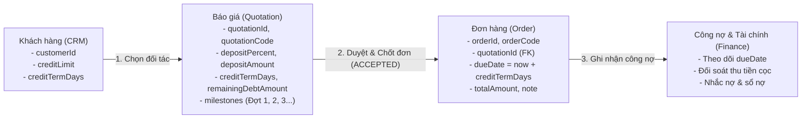

# HƯỚNG DẪN TỔNG QUAN PHÂN HỆ BÁO GIÁ & ĐỐI CHIẾU SANG ĐƠN HÀNG (QUOTATIONS TO ORDERS)

> **Dự án**: AquaSuite IMS (Backend & Frontend)  
> **Tài liệu**: Hướng dẫn kỹ thuật và đặc tả cấu trúc dữ liệu điều khoản Báo giá  
> **Mục tiêu**: Giúp lập trình viên phân hệ **Đơn hàng (Sales Order)** và **Công nợ (Finance/Debt)** nắm rõ cấu trúc dữ liệu, các trường điều khoản (Đặt cọc, Công nợ, Theo đợt) và cách truy xuất, đối chiếu chính xác từ Báo giá sang Đơn hàng.

---

## 1. KIẾN TRÚC TỔNG QUAN & LUỒNG DỮ LIỆU

Trong hệ thống AquaSuite, chu trình bán hàng dự án (Project Sales) kết nối chặt chẽ giữa 4 phân hệ:



---

## 2. CẤU TRÚC DỮ LIỆU DATABASE & JAVA ENTITY

Toàn bộ thông tin điều khoản và thương thảo của Báo giá được lưu trữ tại **2 bảng cơ sở dữ liệu**:

### 2.1. Bảng `public.quotations` (Entity `Quotation.java`)
Lưu trữ thông tin chính của Báo giá cùng các thỏa thuận về **Đặt cọc** và **Công nợ**:

| Tên cột trong DB | Kiểu dữ liệu (PostgreSQL) | Thuộc tính Entity Java | Ý nghĩa & Quy tắc nghiệp vụ |
| :--- | :--- | :--- | :--- |
| `quotation_id` | `UUID` (PRIMARY KEY) | `UUID quotationId` | Khóa chính của bản ghi báo giá. |
| `quotation_code` | `VARCHAR(100)` (UNIQUE) | `String quotationCode` | Mã báo giá (VD: `BG-202611-0001`). |
| `revision_no` | `INT` (DEFAULT 1) | `Integer revisionNo` | Số hiệu phiên bản đàm phán (Rev 1, Rev 2...). |
| `customer_id` | `UUID` (NOT NULL, FK) | `UUID customerId` | ID khách hàng B2B bên phân hệ CRM. |
| `project_name` | `VARCHAR(255)` (NOT NULL) | `String projectName` | Tên dự án / công trình xây dựng. |
| `total_amount` | `NUMERIC(15,2)` (NOT NULL) | `BigDecimal totalAmount` | **Tổng giá trị thanh toán cuối cùng** (đã gồm chiết khấu dòng, thuế VAT và phí ship). |
| `status` | `VARCHAR(32)` (NOT NULL) | `QuotationStatus status` | Trạng thái: `DRAFT`, `PENDING_APPROVAL`, `APPROVED`, `SENT`, `ACCEPTED`, `LOST`, `EXPIRED`, `SUPERSEDED`.<br/>*(Chỉ chuyển thành đơn hàng khi là `ACCEPTED` hoặc `APPROVED`)*. |
| **`deposit_percent`** | `NUMERIC(5,2)` | `BigDecimal depositPercent` | **Tỷ lệ đặt cọc cam kết** (VD: `30.00` tương đương 30% giá trị đơn hàng). |
| **`deposit_amount`** | `NUMERIC(15,2)` | `BigDecimal depositAmount` | **Số tiền đặt cọc quy đổi (VNĐ)** (`= totalAmount * depositPercent / 100`). |
| **`credit_term_days`** | `INT` | `Integer creditTermDays` | **Thời hạn cho nợ tính từ ngày nhận hàng** (VD: `30` ngày). |
| **`remaining_debt_amount`**| `NUMERIC(15,2)` | `BigDecimal remainingDebtAmount` | **Số tiền nợ còn lại (VNĐ)** (`= totalAmount - depositAmount`). |
| **`debt_condition`** | `TEXT` | `String debtCondition` | Điều kiện thanh toán nợ (VD: *"Thanh toán trong vòng 30 ngày kể từ ngày nhận hàng và hóa đơn VAT"*). |
| `delivery_address` | `TEXT` | `String deliveryAddress` | Địa chỉ công trình nhận bàn giao hàng. |
| `delivery_schedule` | `TEXT` | `String deliverySchedule` | Tiến độ bàn giao thỏa thuận (VD: *"Giao 2 đợt theo tầng"*). |
| `quotation_date` | `DATE` (NOT NULL) | `LocalDate quotationDate` | Ngày phát hành báo giá. |
| `valid_until` | `DATE` (NOT NULL) | `LocalDate validUntil` | Ngày hết hạn cam kết giá (mặc định 30 ngày). |
| `vat_rate` | `NUMERIC(5,2)` (NOT NULL) | `BigDecimal vatRate` | Thuế suất GTGT áp dụng: `0`, `8`, hoặc `10`. |
| `shipping_fee` | `NUMERIC(15,2)` (NOT NULL) | `BigDecimal shippingFee` | Cước phí vận chuyển cam kết. |
| `note` | `TEXT` | `String note` | Ghi chú điều khoản thương mại chung. |

---

### 2.2. Bảng `public.quotation_payment_milestones` (Entity `QuotationPaymentMilestone.java`)
Lưu trữ danh sách các đợt thanh toán theo tiến độ (nếu hợp đồng chia làm nhiều đợt):

| Tên cột trong DB | Kiểu dữ liệu | Thuộc tính Entity Java | Ý nghĩa & Quy tắc |
| :--- | :--- | :--- | :--- |
| `milestone_id` | `UUID` (PRIMARY KEY) | `UUID milestoneId` | Khóa chính của đợt thanh toán. |
| `quotation_id` | `UUID` (NOT NULL, FK) | `UUID quotationId` | Khóa ngoại liên kết về `quotations.quotation_id` (CASCADE). |
| `stage_name` | `VARCHAR(100)` (NOT NULL) | `String stageName` | Tên/nội dung đợt (VD: *"Đợt 1: Đặt cọc 30%"*, *"Đợt 2: Khi giao hàng 50%"*). |
| `percent` | `NUMERIC(5,2)` (NOT NULL) | `BigDecimal percent` | Tỷ lệ % thanh toán của đợt đó. |
| `sort_order` | `INT` (DEFAULT 0) | `Integer sortOrder` | Thứ tự đợt thanh toán (1, 2, 3...). |

> **Ràng buộc nghiệp vụ**: Tổng tỷ lệ phần trăm của tất cả các đợt (`SUM(percent)`) bắt buộc phải bằng đúng `100.00%`.

---

## 3. BẢNG ĐỐI CHIẾU (MAPPING TABLE) SANG ĐƠN HÀNG (`Order`)

Khi chuyển Báo giá thành Đơn hàng (`Order`), bảng `public.orders` nhận và đối chiếu các thông tin như sau:

| Trường trong `Order` (`orders`) | Nguồn lấy từ `Quotation` (`quotations`) | Cách thức xử lý / Công thức tính toán |
| :--- | :--- | :--- |
| **`orderId`** (`order_id`) | *Tự sinh mới* | `UUID.randomUUID()` |
| **`orderCode`** (`order_code`) | *Tự sinh mới* | Sinh qua `OrderCodeGenerator` (VD: `SO-20261105-0001`). |
| **`quotationId`** (`quotation_id`) | **`quotation.getQuotationId()`** | **Gán trực tiếp để tạo liên kết 2 chiều giữa Đơn hàng và Báo giá gốc.** |
| **`customerId`** (`customer_id`) | **`quotation.getCustomerId()`** | Khách hàng sở hữu đơn hàng (dùng để link sang sổ nợ CRM/Finance). |
| **`orderType`** (`order_type`) | Cố định: `"PROJECT"` | Đơn hàng từ báo giá luôn là đơn Hợp đồng / Dự án. |
| **`orderChannel`** (`order_channel`) | Cố định: `"DIRECT_SALES"` | Kênh bán hàng trực tiếp / Ký hợp đồng. |
| **`totalAmount`** (`total_amount`) | **`quotation.getTotalAmount()`** | Tổng số tiền thanh toán của đơn hàng. |
| **`dueDate`** (`due_date`) | **`creditTermDays` hoặc `validUntil`** | **Công thức tính hạn thanh toán đơn hàng:**<br/>- Nếu có `creditTermDays > 0`: `order.dueDate = LocalDate.now().plusDays(quotation.getCreditTermDays())`<br/>- Nếu không có: `order.dueDate = quotation.getValidUntil()` (hoặc `now + 30 ngày`). |
| **`deliveryAddress`** (`delivery_address`) | **`quotation.getDeliveryAddress()`** | Địa chỉ nhận hàng công trình. |
| **`note`** (`note`) | **Ghép chuỗi tự động** | `"[Báo giá: " + quotationCode + " (rev." + revisionNo + ")] [Cọc: " + depositPercent + "%] [Công nợ: " + creditTermDays + " ngày] " + userNote` |
| **`orderStatus`** (`order_status`) | Mặc định: `"PROCESSING"` | Đơn hàng chuyển sang trạng thái đang xử lý. |
| **`paymentStatus`** (`payment_status`) | Mặc định: `"UNPAID"` | Chờ phân hệ Finance thu tiền cọc / công nợ để cập nhật sang `PARTIALLY_PAID` hoặc `PAID`. |

---

## 4. HƯỚNG DẪN CODE CHO LẬP TRÌNH VIÊN ĐƠN HÀNG (DEVELOPER GUIDE)

### Cách 1: Sử dụng API / Service có sẵn (Khuyên Dùng)
Hệ thống đã triển khai đầy đủ logic chuyển đổi trong `SalesOrderService`. Bạn chỉ cần inject service và gọi:

```java
package com.aquasuite.ims.module.sales.internal.service;

import com.aquasuite.ims.module.sales.internal.payload.response.SalesOrderDetailResponse;
import org.springframework.beans.factory.annotation.Autowired;
import org.springframework.stereotype.Service;
import java.util.UUID;

@Service
public class OrderCheckoutService {

    @Autowired
    private SalesOrderService salesOrderService;

    public SalesOrderDetailResponse createOrderFromQuote(UUID quotationId) {
        // Tự động validate trạng thái ACCEPTED, tính due_date, kiểm tra tồn kho,
        // giữ chỗ hàng (reserve stock) và gán cọc/nợ vào Đơn hàng:
        return salesOrderService.convertQuotationToOrder(quotationId);
    }
}
```

---

### Cách 2: Tự truy vấn từ Repository
Nếu bạn muốn tự viết luồng xử lý hoặc cần đọc dữ liệu để đối soát công nợ:

```java
package com.aquasuite.ims.module.sales.example;

import com.aquasuite.ims.module.sales.internal.entity.Quotation;
import com.aquasuite.ims.module.sales.internal.entity.QuotationPaymentMilestone;
import com.aquasuite.ims.module.sales.internal.repository.QuotationRepository;
import com.aquasuite.ims.module.sales.internal.repository.QuotationPaymentMilestoneRepository;
import org.springframework.beans.factory.annotation.Autowired;
import org.springframework.stereotype.Component;

import java.math.BigDecimal;
import java.math.RoundingMode;
import java.time.LocalDate;
import java.util.List;
import java.util.UUID;

@Component
public class QuotationDataExtractor {

    @Autowired
    private QuotationRepository quotationRepository;

    @Autowired
    private QuotationPaymentMilestoneRepository milestoneRepository;

    public void extractTermsForOrder(UUID quotationId) {
        // 1. Lấy thông tin Báo giá
        Quotation quotation = quotationRepository.findById(quotationId)
                .orElseThrow(() -> new IllegalArgumentException("Không tìm thấy báo giá ID: " + quotationId));

        BigDecimal tongTien = quotation.getTotalAmount();

        // 2. Lấy thông tin Đặt cọc
        BigDecimal phanTramCoc = quotation.getDepositPercent(); // Ví dụ: 30 (%)
        BigDecimal soTienCoc = quotation.getDepositAmount();     // Ví dụ: 15.000.000 (VNĐ)
        if (soTienCoc == null && phanTramCoc != null) {
            soTienCoc = tongTien.multiply(phanTramCoc).divide(BigDecimal.valueOf(100), 2, RoundingMode.HALF_UP);
        }

        // 3. Lấy thông tin Công nợ
        Integer soNgayChoNo = quotation.getCreditTermDays();    // Ví dụ: 30 (ngày)
        BigDecimal soTienNo = quotation.getRemainingDebtAmount(); // Ví dụ: 35.000.000 (VNĐ)
        if (soTienNo == null && soTienCoc != null) {
            soTienNo = tongTien.subtract(soTienCoc).max(BigDecimal.ZERO);
        }

        // Tính ngày đến hạn thanh toán của Đơn hàng (DueDate)
        LocalDate hanTraNo = (soNgayChoNo != null && soNgayChoNo > 0)
                ? LocalDate.now().plusDays(soNgayChoNo)
                : quotation.getValidUntil();

        // 4. Lấy danh sách các đợt thanh toán (Milestones - nếu có chia đợt)
        List<QuotationPaymentMilestone> milestones =
                milestoneRepository.findByQuotationIdOrderBySortOrderAsc(quotationId);

        for (QuotationPaymentMilestone m : milestones) {
            String tenGiaiDoan = m.getStageName(); // Ví dụ: "Đợt 1: Đặt cọc xác nhận"
            BigDecimal tyLe = m.getPercent();      // Ví dụ: 30 (%)
            BigDecimal soTienDot = tongTien.multiply(tyLe).divide(BigDecimal.valueOf(100), 2, RoundingMode.HALF_UP);
        }
    }
}
```

---

### Cách 3: Tích hợp qua REST API
* **Endpoint lấy chi tiết Báo giá**:
  `GET /api/v1/sales/quotations/{quotationId}`
* **Endpoint chuyển đổi thành Đơn hàng**:
  `POST /api/v1/sales/quotations/{quotationId}/convert-to-order`
  *(Hoặc `POST /api/v1/sales/orders/from-quotation/{quotationId}`)*

#### Ví dụ JSON Response chi tiết (`QuotationResponse`):
```json
{
  "success": true,
  "code": "SUCCESS",
  "message": "Quotation details retrieved successfully",
  "data": {
    "quotationId": "4368ab91-4c3c-453c-8841-c4ff7083629a",
    "quotationCode": "BG-202611-0001",
    "revisionNo": 1,
    "status": "ACCEPTED",
    "customerId": "11111111-2222-3333-4444-555555555501",
    "customerName": "Công ty Xây dựng Hòa Bình",
    "projectName": "Chung cư Grand Marina",
    "totalAmount": 50000000.00,
    "depositPercent": 30.00,
    "depositAmount": 15000000.00,
    "creditTermDays": 30,
    "remainingDebtAmount": 35000000.00,
    "debtCondition": "Thanh toán phần nợ còn lại trong vòng 30 ngày tính từ ngày nhận hàng",
    "milestones": [
      {
        "milestoneId": "6f2e8210-9cf2-4e89-8d88-348e3a2d718b",
        "stageName": "Đợt 1: Đặt cọc xác nhận đơn hàng",
        "percent": 30.00,
        "sortOrder": 1
      },
      {
        "milestoneId": "8a3e7210-1df2-4e89-8d88-348e3a2d719c",
        "stageName": "Đợt 2: Thanh toán khi giao hàng đến công trình",
        "percent": 60.00,
        "sortOrder": 2
      },
      {
        "milestoneId": "9b4e8210-2ef2-4e89-8d88-348e3a2d710d",
        "stageName": "Đợt 3: Quyết toán sau nghiệm thu",
        "percent": 10.00,
        "sortOrder": 3
      }
    ],
    "deliveryAddress": "Số 2 Tôn Đức Thắng, Phường Bến Nghé, Quận 1, TP. HCM",
    "orderId": "bc0029d0-fd15-42ab-a68b-b81e6fb6268e",
    "orderCode": "SO-20261105-0001"
  }
}
```

---

## 5. TỔNG KẾT DÀNH CHO PHÂN HỆ CÔNG NỢ (FINANCE HANDOFF)

1. **Khi Đơn hàng được tạo từ Báo giá**:
   * Mô-đun Đơn hàng đã tự động gán `order.dueDate = Ngày tạo + creditTermDays`.
   * Mô-đun Tài chính (`Finance`) chỉ cần quét trường `Order.dueDate` và `Order.totalAmount` thông qua `SalesReceivableApi` để quản lý sổ nợ, tính tuổi nợ (Aging) và gửi nhắc nợ (Reminder) đúng hạn.
2. **Theo dõi thanh toán theo đợt**:
   * Tiền cọc cần thu đợt 1: Căn cứ theo `quotation.depositAmount` (hoặc mốc đợt 1 trong `quotation_payment_milestones`).
   * Khi khách nộp tiền cọc: Cập nhật `order.paymentStatus = 'PARTIALLY_PAID'`.
   * Khi khách thanh toán đủ toàn bộ công nợ: Cập nhật `order.paymentStatus = 'PAID'`.

