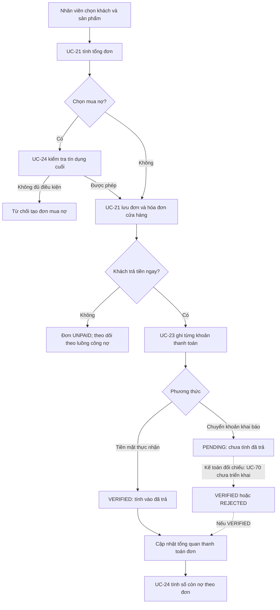
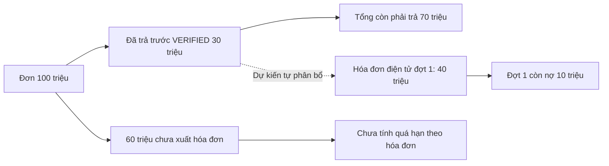

# WORK-018 — Sales, Payment and Receivables Overview

Tài liệu này giúp nhóm hiểu luồng đơn hàng, thanh toán và công nợ tại quầy. Nội dung mô tả **code hiện có trên nhánh WORK-018** và các nghiệp vụ nhóm đã thống nhất nhưng **chưa triển khai**. Thiết kế và code vẫn chờ review; không coi tài liệu này là xác nhận đã sẵn sàng triển khai thực tế.

## Responsibilities

| Use Case | Trách nhiệm | Tình trạng trong phạm vi hiện tại |
|---|---|---|
| UC-21 — Create and Manage Sales Orders | Tạo đơn tại quầy, gọi kiểm tra mua nợ khi chọn CREDIT, tạo hóa đơn cửa hàng cùng đơn | Đã bổ sung code BE; cần review sau triển khai |
| UC-23 — Manage Payment | Nhân viên ghi tiền mặt hoặc chuyển khoản, xem giao dịch và số tiền còn thiếu của đơn | Đã bổ sung API BE tại quầy; chưa có FE |
| UC-24 — Manage Customer Debt and Receivables | Kiểm tra khách có được mua nợ và theo dõi công nợ | Đã có code; WORK-018 bổ sung kiểm tra kỳ hạn và điều chỉnh cách nhận diện tiền chưa phân bổ vào hóa đơn đã phát hành |
| UC-70 — Process Pending Payment Verifications | Kế toán xác minh hoặc từ chối khoản chuyển khoản | Luồng xác minh chưa được triển khai trong WORK-018 |
| UC-63 — Manage Receipts and Payment Allocation | Phân bổ khoản tiền vào hóa đơn điện tử theo đợt | Nguyên tắc đã thống nhất; cơ chế phân bổ chưa triển khai trong WORK-018 |
| UC-18 / UC-22 | Đặt hàng online / xử lý đơn online | Tích hợp thanh toán website để giai đoạn sau |

## Order and Payment Flow

Sơ đồ dùng đường nét đứt cho bước **chưa triển khai trong work này**.



1. Nhân viên tạo đơn qua UC-21. Đơn mới có trạng thái thanh toán `UNPAID`; việc chọn phương thức dự kiến không tự tạo khoản thu.
2. Với đơn `CREDIT`, UC-21 gọi contract UC-24 kiểm tra theo toàn bộ tổng đơn. Khách `BLOCKED` không được tạo đơn mới; kỳ hạn tín dụng phải từ 1–30 ngày.
3. UC-21 lưu hóa đơn cửa hàng loại `STORE`, trạng thái `DRAFT`, và các dòng hàng trong cùng transaction với đơn. Đây chưa phải hóa đơn điện tử từng đợt.
4. Sau khi đã có đơn, nhân viên có thể ghi khoản thanh toán qua UC-23. Sales Staff và Shop Owner được ghi và xem; Accountant được xem. API ghi nhận không hỗ trợ thẻ.
5. Tiền mặt nhân viên đã nhận được lưu `VERIFIED` và cập nhật trạng thái thanh toán của đơn. Chuyển khoản nhân viên khai báo được lưu `PENDING`, có thể đính kèm chứng từ; chưa được tính là đã thu.
6. Một khoản `PENDING` không chặn nhân viên ghi khoản khác. Việc kế toán xác minh và xử lý tiền thực nhận vượt nghĩa vụ thuộc UC-70, chưa có trong work này.

`COUNTER` là kênh bán tại quầy. Khi tạo đơn, API nhận `COUNTER` hoặc `POS` và lưu đơn mới là `COUNTER`; `IN_STORE` không còn là giá trị request hợp lệ. UC-24 nhận `COUNTER` và `POS` khi kiểm tra tín dụng. `IN_STORE_PICKUP` là phương thức nhận hàng, không phải kênh bán. Đơn lịch sử có thể vẫn trả về `IN_STORE`; cần kiểm kê caller và dữ liệu cũ trước phát hành.

### Historical Data Inventory

Người dùng xác nhận dữ liệu hiện tại là mockup và không yêu cầu giữ tương thích với dữ liệu cũ. Không cần chuyển đổi dữ liệu mockup trong WORK-018; chỉ nhóm/người dùng quyết định việc tạo lại hoặc xóa database. Các truy vấn chỉ đọc sau phục vụ kiểm kê nếu sau này cần đánh giá một môi trường có dữ liệu cần giữ.

```sql
SELECT invoice_type, status, COUNT(*) AS invoice_count
FROM sales_invoices
GROUP BY invoice_type, status
ORDER BY invoice_type, status;

SELECT order_channel, COUNT(*) AS order_count
FROM orders
GROUP BY order_channel
ORDER BY order_channel;
```

Hiện UC-24 loại `STORE` khỏi hóa đơn tính hạn và xét các loại khác ở trạng thái `ISSUED`. Trước khi dùng dữ liệu cần giữ, chủ dữ liệu cần xác nhận các loại hóa đơn, nhất là loại nội bộ khác `STORE`. Caller bên ngoài backend cần gửi `COUNTER` hoặc `POS`; không đổi `IN_STORE_PICKUP`.

## Payment Calculation

```text
Đã trả       = Tổng khoản thu RECEIPT có trạng thái VERIFIED của đơn
Đang chờ     = Tổng khoản thu RECEIPT có trạng thái PENDING của đơn
Còn phải trả = max(Tổng tiền đơn - Đã trả, 0)
```

Với tổng đơn dương: chưa có khoản xác minh là `UNPAID`; đã xác minh một phần là `PARTIALLY_PAID`; đã xác minh đủ là `PAID`. `PENDING` không làm giảm số còn phải trả. Mỗi lần khách thanh toán được lưu thành một transaction riêng.

Ví dụ đơn 10 triệu: khách đã đưa 3 triệu tiền mặt, sau đó khai báo chuyển khoản 7 triệu. Hệ thống ghi 3 triệu `VERIFIED`, 7 triệu `PENDING`: đã trả 3 triệu, còn phải trả 7 triệu, trạng thái `PARTIALLY_PAID`. Khi UC-70 được triển khai và xác minh thành công khoản chuyển khoản, hệ thống mới tính khoản 7 triệu là đã thu.

## Store Invoice and Electronic Invoices

| Chứng từ | Mục đích và thời điểm | Tình trạng |
|---|---|---|
| Hóa đơn cửa hàng | Được tạo với đơn để theo dõi thông tin bán hàng, tổng đơn và các khoản trả | Đã có BE tạo bản ghi `STORE` / `DRAFT`; không tự tính hạn nợ hóa đơn điện tử |
| Hóa đơn điện tử theo đợt | Theo thỏa thuận nhóm, kế toán liên kết theo phần hàng khách đã nhận | Chưa có luồng liên kết theo đợt trong WORK-018 |
| Chứng từ thanh toán | Biên lai hoặc tệp bằng chứng cho một khoản chuyển khoản | API BE cho phép thêm một tệp cho giao dịch `PENDING`; xác minh thực nhận thuộc UC-70 |

Theo nghiệp vụ nhóm chốt, hạn thanh toán từng đợt tính từ ngày phát hành hóa đơn điện tử của đợt cộng thời hạn công nợ của khách. Cần phối hợp với người làm hóa đơn và UC-24 để phân biệt chính xác loại, trạng thái và ngày phát hành; không dùng ngày tạo hóa đơn cửa hàng như ngày hóa đơn điện tử.

## Allocation Example — Planned

Quy tắc phân bổ dưới đây **đã được nhóm thống nhất về nghiệp vụ nhưng code tự phân bổ/chọn phân bổ chưa được triển khai**:



- Tiền cọc/trả trước đã `VERIFIED` được tự phân bổ vào hóa đơn điện tử đợt đầu; phần dư dự kiến tự chuyển sang các đợt tiếp theo **của cùng đơn**.
- Với khoản khách trả sau, kế toán kiểm tra và chọn hóa đơn khách thanh toán. Tiền `PENDING` chưa được phân bổ.
- Việc phân bổ dùng khoản thu đã có, không tạo một transaction thu tiền thứ hai. `Transaction.invoiceId` hiện chỉ lưu một ID; cần thiết kế dữ liệu phân bổ riêng và phối hợp UC-24/UC-63 trước khi triển khai chia tiền cho nhiều hóa đơn.
- UC-24 hiện tính tiền đã trả theo đơn. Khoản gắn hóa đơn cửa hàng `DRAFT` được thể hiện là chưa phân bổ vào hóa đơn điện tử đã phát hành; không tự giảm dư nợ hóa đơn điện tử.

## Backend APIs

Các API sau là API tại quầy hiện có; quyền được kiểm tra ở BE. `{orderId}` và `{paymentId}` là UUID.

| Method | Path | Người dùng | Mục đích |
|---|---|---|---|
| POST | `/api/v1/finance/orders/{orderId}/payments` | Sales Staff, Shop Owner | Ghi một khoản thanh toán |
| GET | `/api/v1/finance/orders/{orderId}/payments` | Sales Staff, Shop Owner, Accountant | Xem lịch sử khoản thu |
| GET | `/api/v1/finance/orders/{orderId}/payment-summary` | Sales Staff, Shop Owner, Accountant | Xem tổng đơn, đã trả, đang chờ, còn thiếu |
| POST | `/api/v1/finance/orders/{orderId}/payments/{paymentId}/proof` | Sales Staff, Shop Owner | Tải tệp `file` cho chuyển khoản Pending |
| GET | `/api/v1/finance/orders/{orderId}/payments/{paymentId}/proof` | Sales Staff, Shop Owner, Accountant | Tải chứng từ có quyền truy cập |

Ví dụ body ghi 3 triệu tiền mặt:

```json
{
  "idempotencyKey": "6af48b13-d428-4f93-951f-d3b3e8e69f9a",
  "amount": 3000000,
  "paymentMethod": "CASH",
  "referenceNo": null,
  "description": "Khách trả trước tại quầy"
}
```

Client tạo một UUID `idempotencyKey` cho mỗi khoản thanh toán mới; khi **cùng nhân viên** gửi lại cùng yêu cầu thì giữ nguyên UUID và dữ liệu. Chuyển khoản dùng `BANK_TRANSFER`; mã tham chiếu và ghi chú là tùy chọn. Chứng từ được gửi riêng bằng multipart `file`, tối đa 5 MB, nhận PNG/JPEG/PDF theo chữ ký tệp; BE lưu trong PostgreSQL, không trả URL công khai. Mỗi khoản hiện có tối đa một chứng từ.

## Integration and Verification Notes

- Hai đơn mua nợ đồng thời và hai khoản tiền mặt đồng thời đã có test PostgreSQL; vẫn cần review độc lập về contract, bảo mật và mọi đường thay đổi công nợ/đơn.
- Migration V6 kiểm tra hồ sơ tín dụng cũ và dừng nếu dữ liệu vi phạm; V7 kiểm tra tính duy nhất hóa đơn `STORE` theo đơn; V8 thêm khóa chống ghi trùng; V9 thêm lưu chứng từ. Các migration chưa được áp dụng lên database làm việc của nhóm.
- Bruno đã chạy trên môi trường tạm: 12 request / 13 test đạt. Full suite gần nhất: 549 test, 1 failure, 1 error và 1 skipped; hai lỗi thuộc `QuotationEntityConstraintTest` phần báo giá, cần người phụ trách đối chiếu. Full suite chưa đạt; xem [WORK-018 Feature Spec](../specifications/WORK-018-uc23-order-payments.md) để biết các quyết định còn mở.
- UC-70, UC-63, kết nối UC-18 và cách xử lý tiền thực nhận vượt nghĩa vụ chưa được triển khai trong work này. Sau khi UC-23/UC-70 hoàn thiện, nhóm cần tài liệu tích hợp UC-18 theo contract thực tế.
