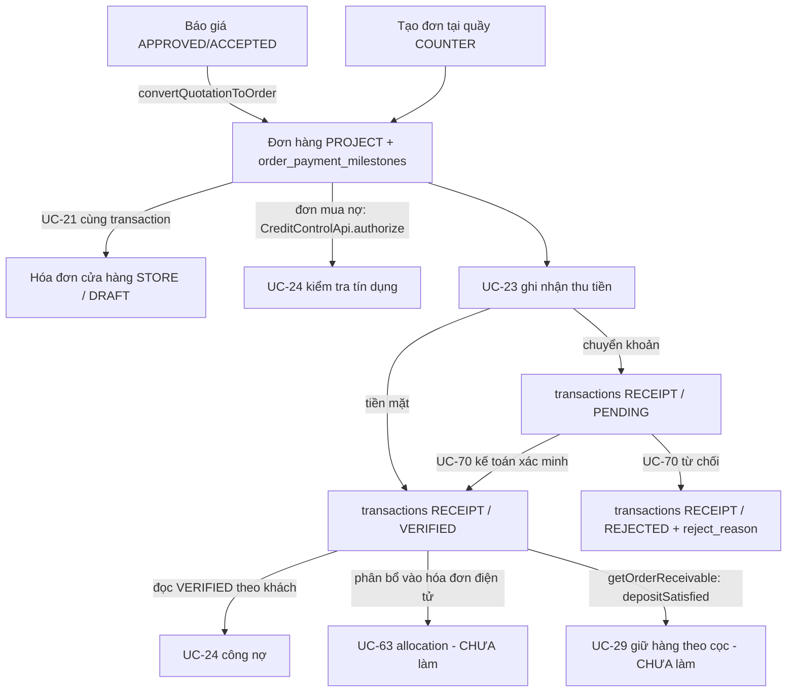

# Bàn giao tích hợp: Báo giá → UC-21 → UC-23 → UC-70 cho UC-24 / UC-63

> **Mục đích:** mô tả luồng và **hợp đồng dữ liệu** mà phần thanh toán (UC-21 tạo đơn, UC-23 ghi nhận, UC-70 xác minh) bảo đảm, để người phụ trách **UC-24 (công nợ)** và **UC-63 (phân bổ hóa đơn điện tử)** xây dựng cho khớp.
>
> **Đối tượng đọc:** Hào (UC-24 / UC-63) và reviewer liên module `sales` ↔ `finance`.
>
> **Trạng thái:** mô tả hiện trạng code đã chạy (UC-21/23/70) + điểm còn mở cho UC-24/63. Không phải contract đã Design Review chính thức.

---

## 1. Toàn cảnh luồng



**Tóm tắt:** Báo giá (hoặc POS) tạo **đơn** + **các mốc thanh toán** + **hóa đơn cửa hàng STORE**. UC-23 ghi khoản thu vào bảng `transactions`. UC-70 lật PENDING → VERIFIED/REJECTED. UC-24 và UC-63 **đọc sổ `transactions`** làm nguồn sự thật, **không** tự tạo khoản thu.

---

## 2. Nguồn sự thật: bảng `transactions`

Mọi khoản khách trả đều là một dòng `transactions`. UC-24/UC-63 phải đọc từ đây, không suy ra từ nơi khác.

| Trường | Ý nghĩa | Ai ghi |
|---|---|---|
| `transaction_type` | Luôn `RECEIPT` cho khoản khách trả | UC-23 |
| `category` | `CUSTOMER_PAYMENT` | UC-23 |
| `payment_method` | `CASH` hoặc `BANK_TRANSFER` | UC-23 |
| `status` | `VERIFIED` / `PENDING` / `REJECTED` | UC-23 (tạo), UC-70 (đổi) |
| `customer_id` | = `order.customer_id` của đơn | UC-23 |
| `order_id` | Đơn của khoản thu | UC-23 |
| `invoice_id` | = hóa đơn **cửa hàng STORE** của đơn (có thể null với đơn cũ) | UC-23 |
| `amount` | Số tiền (BigDecimal, scale 2) | UC-23 |
| `reference_no` | Mã tham chiếu CK khách khai (không bắt buộc) | UC-23 |
| `idempotency_key` | Duy nhất; chống ghi trùng | UC-23 |
| `approved_by` / `approved_at` | Người + thời điểm **ra quyết định** (verify hoặc reject) | UC-23 (tiền mặt tự verify), UC-70 |
| `reject_reason` | Lý do từ chối (chỉ có khi `REJECTED`) | UC-70 (migration V15) |

### Ngữ nghĩa trạng thái (BẮT BUỘC tuân thủ)

- **`VERIFIED`** = tiền đã thực nhận. **Chỉ khoản này mới được tính là đã thu.**
- **`PENDING`** = khách khai chuyển khoản, **chưa** chắc nhận tiền. **KHÔNG tính là đã thu**, hiển thị riêng.
- **`REJECTED`** = kế toán từ chối. **Bỏ qua**, không tính đã thu.

Công thức UC-23/UC-70 đang dùng (UC-24 nên nhất quán):
```
verifiedPaid  = Σ amount các RECEIPT có status=VERIFIED của phạm vi (đơn hoặc khách)
pendingAmount = Σ amount các RECEIPT có status=PENDING
remaining(đơn) = max(order.totalAmount - verifiedPaid, 0)
```

---

## 3. UC-24 (công nợ) đã tiêu thụ gì

Hiện `CustomerDebtServiceImpl` **đã** đọc đúng:
```java
transactionRepository.findByCustomerIdInAndStatusIgnoreCase(customerIds, "VERIFIED")
    .filter(t -> "RECEIPT".equalsIgnoreCase(t.getTransactionType()))
```
→ Khi UC-23 ghi tiền mặt (VERIFIED) hoặc UC-70 xác minh chuyển khoản (PENDING→VERIFIED), **UC-24 tự thấy ngay ở lần tính kế tiếp** — không cần event/batch.

**Quy ước đã chốt UC-24 phải giữ:**
- Khoản `VERIFIED` chỉ gắn `order_id` (hoặc gắn hóa đơn **STORE**) được coi là **chưa phân bổ vào hóa đơn điện tử** (`unallocatedVerifiedReceiptAmount`). Không coi hóa đơn STORE là hóa đơn điện tử `ISSUED`.
- Không cộng `PENDING` vào đã thu; không trừ khoản thiếu của mốc một lần nữa vào tổng nợ.

---

## 4. Các mốc thanh toán của đơn (`order_payment_milestones`)

- Khi chuyển báo giá → đơn, hệ sao chép mốc: `stage_name`, `percent`, `amount` (tính theo tổng đơn), `sort_order`.
- **UC-23** tính *tiến độ theo mốc* = phân bổ tuần tự tiền **VERIFIED** vào từng mốc (chỉ để hiển thị thỏa thuận).
- ⚠️ **Phân biệt rõ cho UC-63:** "tiến độ theo mốc của đơn" (UC-23) **KHÁC** "phân bổ khoản thu vào hóa đơn điện tử" (UC-63). Hai việc độc lập; không được coi mốc đã trả là hóa đơn đã thanh toán.
- Đọc mốc chỉ-đọc qua `SalesOrderApi.getOrderPaymentMilestones(orderId)` (projection, không import `sales.internal`).

---

## 5. Hợp đồng liên module (đã có, dùng lại — không tự thêm)

| Contract | Chiều | Dùng để |
|---|---|---|
| `SalesOrderApi.getOrderPaymentInfo/lockOrderPaymentInfo` | finance → sales | Đọc/khóa đơn (tổng tiền, trạng thái, storeInvoiceId) |
| `SalesOrderApi.updatePaymentStatus` | finance → sales | UC-23/UC-70 cập nhật `paymentStatus` đơn trong cùng transaction đã khóa |
| `SalesOrderApi.getOrderPaymentMilestones` | finance → sales | Đọc mốc để tính tiến độ |
| `SalesReceivableApi.findOrders/Invoices/OrderById` | finance → sales | UC-24 đọc đơn & hóa đơn công nợ |
| `CreditControlApi.requireCustomerOrderAllowed / authorize` | sales → finance | UC-21 kiểm tra khách BLOCKED + hạn mức mua nợ khi tạo đơn |
| `OrderReceivableApi.getOrderReceivable(orderId)` | bất kỳ module → finance | UC-29 đọc verifiedPaid / remaining / tình trạng cọc của đơn để quyết định giữ hàng |

**Nguyên tắc:** chỉ chia sẻ qua `*.api`; cấm import `*.internal` chéo module; liên kết dữ liệu chéo module bằng **scalar UUID**, không JPA association.

---

## 6. Bảo đảm về đồng thời / an toàn (UC-24/63 dựa vào được)

- UC-23 và UC-70 **khóa đơn** (`lockOrderPaymentInfo`) rồi mới đọc số dư và ghi, giữ khóa đến commit → không cộng vượt nghĩa vụ.
- UC-70 verify còn khóa chính giao dịch (`findByIdForUpdate`, đọc trạng thái dưới khóa) → hai kế toán không xác minh trùng, không cộng tiền 2 lần.
- `updatePaymentStatus` cập nhật `order.paymentStatus` trong cùng transaction → không lệch tiền ↔ trạng thái.
- **UC-63 khi phân bổ phải theo cùng giao thức khóa đơn** để không chạy đua với UC-23/UC-70.

---

## 7. Việc còn mở — UC-24/UC-63 cần thiết kế (CHƯA có code)

1. **Bảng allocation của UC-63:** mỗi dòng gắn (transaction, hóa đơn điện tử, số tiền); cho phép một khoản thu chia nhiều hóa đơn. `transactions.invoice_id` hiện **chỉ** trỏ hóa đơn STORE, **không** biểu diễn phân bổ nhiều đợt — đừng dùng nó làm dữ liệu allocation.
2. **Hóa đơn điện tử theo đợt + hạn nợ:** UC-24 tính quá hạn từ ngày phát hành hóa đơn điện tử `ISSUED` (không phải STORE) + kỳ hạn công nợ.
3. **Tự phân bổ tiền cọc/trả trước** vào hóa đơn đợt đầu, phần dư sang đợt sau cùng đơn; khoản trả sau để kế toán chọn hóa đơn. **Không** phân bổ PENDING, **không** tạo giao dịch thu mới.
4. **Tiền thực nhận vượt nghĩa vụ** (sau UC-70 verify): hiện UC-70 **chặn** verify nếu vượt (giữ PENDING). Cách xử lý thu thừa/hoàn trả cần thiết kế cùng quy trình điều chỉnh.
5. **Đơn hủy/điều chỉnh (UC-26):** chưa chốt hành vi verify/allocation cho đơn hủy — phối hợp trước khi tích hợp.

---

## 8. KHÔNG được làm (bất biến)

- ❌ Không tạo giao dịch thu thứ hai khi phân bổ (một đồng tiền chỉ đếm một lần).
- ❌ Không tự chuyển tiền giữa các đơn; tiền chỉ thuộc đơn của giao dịch.
- ❌ Không ghi nhận/allocate khoản `PENDING` hay `REJECTED` như đã thu.
- ❌ Không coi hóa đơn cửa hàng `STORE` là hóa đơn điện tử `ISSUED`.
- ❌ Không sửa/xóa giao dịch đã `VERIFIED` để che sai lệch; điều chỉnh/đảo cần luồng riêng được duyệt.

---

## 9. Ví dụ đối chiếu

**A. Tiến độ mốc (UC-23):** Đơn 100tr, mốc 30/40/30, thu VERIFIED 40tr → mốc 1 đủ (30), mốc 2 trả 10/còn 30, mốc 3 còn 30; toàn đơn đã trả 40, còn 60. Thêm 20tr PENDING không đổi tiến độ.

**B. UC-70 → UC-24:** Đơn 100tr đã thu tiền mặt 30tr (VERIFIED) → UC-24 outstanding phản ánh 30tr đã thu. Khách CK 70tr (PENDING) → UC-24 **chưa** trừ. Kế toán UC-70 **verify 70tr** → status VERIFIED → UC-24 lần đọc sau trừ đủ, đơn `PAID`.

**C. Vượt nghĩa vụ:** Đơn 10tr, hai CK 7tr + 6tr cùng PENDING. Verify 7tr → còn 3tr. Verify 6tr → **báo lỗi VER_003**, giữ PENDING; kế toán/chủ cửa hàng tự xử lý với khách ngoài hệ thống.

---

## 10. UC-29 — Giữ hàng theo cọc (public API `OrderReceivableApi`)

UC-29 giữ hàng khi khách **đã cọc đủ**. "Đã cọc" = có khoản thu **VERIFIED** đủ mức cọc — dữ liệu này do UC-23/UC-70 tạo. Finance cung cấp hợp đồng công khai để UC-29 đọc, không cần import `finance.internal`.

### Hợp đồng
```java
// com.aquasuite.ims.module.finance.api
Optional<OrderReceivableView> getOrderReceivable(UUID orderId);
```
`OrderReceivableView`: `orderId, totalAmount, verifiedPaid, pendingAmount, remaining, paymentStatus, depositRequired, depositSatisfied`.

- **`depositRequired`** = ưu tiên `order.deposit_amount`; nếu không có thì lấy **số tiền mốc đầu tiên** ("Đặt cọc"); 0 nếu không xác định.
- **`depositSatisfied`** = `true` khi `verifiedPaid ≥ depositRequired` (và `depositRequired > 0`).
- Khoản **PENDING KHÔNG** làm thỏa cọc (tiền chưa chắc về) → chỉ giữ hàng khi đã VERIFIED.

### Cách UC-29 dùng
```java
orderReceivableApi.getOrderReceivable(orderId)
    .filter(OrderReceivableView::depositSatisfied)
    .ifPresent(v -> reserveStock(orderId)); // chỉ giữ hàng khi đã cọc đủ
```

### Ràng buộc UC-29 phải lưu ý
- Nếu `depositRequired == 0` (đơn không đặt cọc, không mốc) → `depositSatisfied=false`; UC-29 tự chọn ngưỡng khác từ `verifiedPaid` nếu cần.
- Sau khi giữ hàng, nếu khoản cọc bị **UC-70 từ chối** hoặc **đơn bị hủy (UC-26)** → UC-29 phải có cơ chế **nhả hàng (release)**. API này chỉ cho biết tình trạng hiện tại, không tự nhả hàng.
- API chỉ đọc, không tạo/sửa giao dịch; gọi lúc nào cũng phản ánh ảnh chụp nhất quán của sổ giao dịch.

## 11. Tham chiếu

- Tổng quan luồng + sơ đồ: [`WORK-018-sales-payment-overview.md`](WORK-018-sales-payment-overview.md)
- Spec UC-23: [`../specifications/WORK-018-uc23-order-payments.md`](../specifications/WORK-018-uc23-order-payments.md)
- Spec UC-70: [`../specifications/WORK-019-uc70-pending-payment-verifications.md`](../specifications/WORK-019-uc70-pending-payment-verifications.md)
- Quy ước contract liên module: [`../architecture/module-contracts.md`](../architecture/module-contracts.md)
