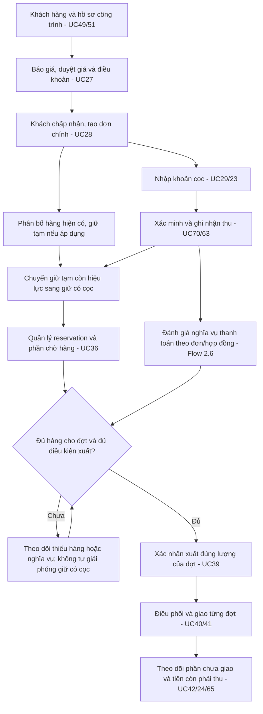

# Báo cáo đối chiếu luồng nghiệp vụ, use case và database AquaSuite

Ngày lập: 31/10/2026 (Asia/Saigon). Trạng thái: **BẢN ĐỐI CHIẾU ĐỂ THỐNG NHẤT NGHIỆP VỤ — CHƯA PHẢI ĐẶC TẢ ĐÃ DUYỆT**.

## 1. Mục đích, phạm vi và cách đọc

Báo cáo tổng hợp luồng hiện được mô tả trong Report 3 và bộ use case GitHub, đối chiếu tài liệu database với migration/entity trong backend, rồi xác định các điểm cần làm rõ trước khi triển khai. Trọng tâm là đơn công trình, cọc, giữ hàng, công nợ, kiểm soát quyền xuất, giao nhiều đợt và hủy/giảm đơn. Sáu business flow tổng thể đều được đưa vào đối chiếu; báo cáo không thay thế đặc tả của toàn bộ 66 UC.

Phân loại thông tin:

| Nhãn | Ý nghĩa |
|---|---|
| Hiện trạng tài liệu | Nội dung đang được viết trong nguồn được dẫn; không đồng nghĩa đã triển khai |
| Hiện trạng source/schema | Đã đọc trong source hoặc migration; không chứng nhận database triển khai thực tế |
| Đã thống nhất nghiệp vụ | Quyết định người dùng đã nêu trong phiên trao đổi/báo cáo bàn giao |
| Đề xuất | Phương án để xem xét, chưa được coi là yêu cầu được phê duyệt |
| Cần làm rõ | Chưa đủ quyết định hoặc có mâu thuẫn giữa các nguồn |

Chỉ bổ sung báo cáo. Không thay đổi source, migration, database, Report 3 hoặc repository BA. Không suy diễn sự hiện diện của entity thành một luồng nghiệp vụ đã hoạt động.

### 1.1. Nguồn và mốc đối chiếu

| Mã | Nguồn | Phạm vi đã đọc |
|---|---|---|
| S1 | `D:\AQS_Report-3_Software Requirement Specification_v1.2_29092026.pdf` | 141 trang; business flow mục I.2 và 6 sơ đồ tại trang PDF 5–8; mô hình dữ liệu/rule trang 9–16; UC liên quan và phụ lục business rules |
| S2 | [Repository BA — usecase-description](https://github.com/GiangHieuToiDay/aqs-ba/tree/a6022b66f326c9acde946de159d106dbb2579f05/usecase-description) | Bản chụp tại commit `a6022b66f326c9acde946de159d106dbb2579f05`; bản gộp và 14 file FE có cùng nội dung thân của 66 UC sau chuẩn hóa khoảng trắng; đọc chi tiết các UC thuộc chuỗi nghiệp vụ trong mục 5 |
| S3 | `D:\Database (2).pdf` | 24 trang; khách hàng/công trình, tồn kho, mua hàng, báo giá/đơn, giao hàng và giao dịch tiền |
| S4 | Backend tại commit `a818c69752898d713ebb8c081415641516aa368d` | Migration, entity và API/service liên quan; working tree sạch trước khi tạo báo cáo |
| S5 | Trao đổi nghiệp vụ với người dùng | Báo cáo bàn giao và các quyết định tại mục 3 dưới đây |

Số trang trong báo cáo là số trang PDF tính từ trang bìa, bắt đầu bằng 1. Tên file S1 không được dùng để suy ra phiên bản mới/cũ hơn GitHub; các nguồn có nội dung khác nhau nên cần owner xác nhận phạm vi áp dụng.

Nguồn backend: [bản đồ tài liệu](../README.md), [kiến trúc](../architecture/Architecture-Aquasuite.md), [module contracts](../architecture/module-contracts.md), [API conventions](../contracts/api-conventions.md), [workflow](../workflow/feature-delivery.md). Running code xác định hiện trạng; approved spec xác định mục tiêu. Báo cáo giữ các xung đột ở trạng thái mở, không tự thay đổi thứ tự ưu tiên hay hợp thức hóa implementation.

## 2. Kết quả chính

1. Đã có nền dữ liệu đơn hàng, giao dịch tiền, tồn tổng và giao nhiều đợt, nhưng chưa có đầy đủ luồng tích hợp cọc/giữ hàng/xuất theo nghĩa vụ thanh toán.
2. Report 3 mục 2.6 phân biệt **xác minh tiền** với **đủ điều kiện xuất kho**. Nhận cọc không tự động cho phép xuất mọi đợt hàng.
3. UC-18, UC-21, UC-22, UC-28 và UC-29 đều nhắc giữ/khóa hàng. Phải thống nhất một vòng đời reservation để tránh cộng giữ nhiều lần.
4. Số tổng `reserved_qty` chưa cho biết giữ cho đơn nào, dòng nào, giao đợt nào hay yêu cầu nào đã xử lý.
5. UC-51 yêu cầu công trình có hồ sơ riêng; Database PDF tham chiếu bảng công trình chưa định nghĩa; source hiện có tên công trình trên báo giá và ID công trình trên đơn nhưng chưa có hồ sơ CRM tương ứng.
6. Mốc trừ tồn, quyền hủy/hoàn cọc, ghi nhận COD, công nợ/báo cáo và tên trạng thái chưa thống nhất giữa các tài liệu.
7. Tỷ lệ cọc 30%/20% và cách chuyển reservation mới là đề xuất; chưa được xem là quyết định đã chốt.

## 3. Các nghiệp vụ đã thống nhất và giới hạn của quyết định

| Mã | Nội dung đã thống nhất | Giới hạn cần giữ rõ |
|---|---|---|
| B01 | Cọc gắn với đơn hàng chính của công trình | Đơn bổ sung xử lý riêng, không tự dùng chung cọc |
| B02 | Giá và chiết khấu phải được chốt/duyệt trước khi tính cọc | Chưa chốt quyền duyệt ngoại lệ mức cọc |
| B03 | Được nhận cọc dù chưa đủ toàn bộ hàng; giao nhiều đợt, phần thiếu giao sau | Chỉ giữ lượng thực sự phân bổ được; không giữ âm tồn |
| B04 | Giữ hàng không giảm tồn vật lý | Mốc xuất cụ thể gây giảm tồn còn mâu thuẫn giữa nguồn |
| B05 | Với đơn đã cọc, quản lý bằng lịch giao; không tự giải phóng vì quá ngày hẹn hoặc còn nợ | Hủy/giảm đơn, xuất hàng và quyết định xử lý hợp lệ mới thay đổi lượng giữ |
| B06 | Sau cọc, phần tiền còn lại theo dõi là số còn phải thu; hạn do hai bên thỏa thuận, có hợp đồng thì theo hợp đồng | Chưa đồng nghĩa đã chốt thời điểm ghi nhận AR/doanh thu kế toán; xuất hàng vẫn xét điều khoản thanh toán |
| B07 | Kế toán duyệt hủy/giảm; hủy giải phóng hết và hoàn cọc, giảm giải phóng phần giảm | Phải làm rõ trường hợp đã xuất/giao một phần, cọc cần hoàn khi giảm và quyền duyệt phiếu chi |
| B08 | Cọc, reservation, giao hàng và công nợ có vòng đời riêng | Giao đủ không đồng nghĩa trả đủ; chưa được xuất không đồng nghĩa mất quyền giữ |

Chưa có xác nhận cuối cùng cho đề xuất cọc mặc định 30%, tối thiểu 20%, dưới mức này do Chủ cửa hàng duyệt. Không hardcode các tỷ lệ này từ báo cáo.

## 4. Sáu business flow trong Report 3

### 4.1. Mục 2.1 — Payment Processing & Reconciliation

**Hiện trạng tài liệu:** bắt đầu khi khách trả tiền tại quầy/chuyển khoản/trả nợ hoặc Shipper nộp COD. Sơ đồ tách nhánh tiền tại quầy và nhánh đối soát chuyển khoản; Kế toán kiểm tra giao dịch, đối chiếu đơn/khách, xác minh hoặc yêu cầu làm rõ, tạo receipt. Hệ thống cập nhật số đã trả, số còn thiếu và trạng thái thanh toán; cập nhật dư nợ nếu áp dụng.

**Điểm cần thống nhất:** nhánh tiền tại quầy đang đặt thẳng `Paid`, chưa có nhánh cọc/trả một phần. Nhánh chuyển khoản có kiểm tra hợp lệ nhưng chưa mô tả chống ghi nhận lại cùng giao dịch. Cần phân biệt xác nhận khách đã trả COD với việc Shipper nộp tiền về cửa hàng.

**Liên hệ UC:** UC-23, UC-30, UC-63, UC-70; tra cứu/đối soát bởi UC-24, UC-62, UC-65.

### 4.2. Mục 2.2 — Import products from suppliers

**Hiện trạng tài liệu:** Chủ cửa hàng lập và gửi chứng từ, trao đổi chỉnh sửa với nhà cung cấp, chọn thanh toán một lần/nhiều đợt. Nhân viên nhận và kiểm tra chất lượng; hàng lỗi có nhánh trả, hàng đạt được nhập; lặp cho các đợt tiếp theo.

**Điểm cần thống nhất:** sơ đồ dùng “goods receipt note” cho cả giai đoạn đề nghị mua/gửi nhà cung cấp; trong schema/UC hiện có hai khái niệm riêng là Purchase Order và Goods Receipt. Không nên gộp đề nghị mua với xác nhận hàng đã thực nhận. Cần làm rõ sơ đồ có bắt buộc thanh toán trước mọi lần giao của nhà cung cấp hay chỉ là nhánh ví dụ, vì UC-33/66 có điều khoản mua chịu.

**Liên hệ UC:** UC-32, UC-33, UC-34, UC-37, UC-64, UC-66. Nguồn hàng nhập bổ sung có thể đáp ứng phần chờ của đơn công trình, nhưng chưa có chính sách ưu tiên phân bổ được duyệt.

### 4.3. Mục 2.3 — Goods Issue Note

**Hiện trạng tài liệu:** lập chứng từ xuất, kiểm tra hợp lệ, chọn xuất một lần/nhiều đợt; trừ lượng của từng đợt, theo dõi đợt tiếp theo, có nhánh xử lý tồn và nợ/trả nhiều lần.

**Điểm cần thống nhất:** diễn đạt “delivered quantities” trong phần mô tả chưa xác định là xuất khỏi kho hay khách đã nhận. Sơ đồ chưa tách rõ xác nhận xuất, chuyến xe và kết quả giao; nhánh cập nhật thanh toán trên phiếu xuất phải dùng kết quả thu tiền thay vì tạo một sổ thu riêng.

**Liên hệ UC:** UC-39–43, kết nối UC-36 và flow 2.6. Đây là nền cho giao một đơn qua nhiều đợt.

### 4.4. Mục 2.4 — Offline and Online Sales Order Process

**Hiện trạng tài liệu:** tiếp nhận theo kênh online/tại quầy, nhận diện khách cá nhân/doanh nghiệp, tư vấn, chốt SKU/số lượng/giá, kiểm tra tồn, lập hợp đồng khi phù hợp, chọn thanh toán, kiểm tra cọc và xác nhận. Có nhánh điều chỉnh đề xuất, nhắc cọc và hủy/hoàn tiền.

Phần mô tả yêu cầu khách nhận hàng thành công mới đóng đơn; không thể dùng một cờ “hoàn thành” để suy ra tất toán công nợ.

**Điểm cần thống nhất:** sơ đồ đặt việc tạo đơn ở cuối sau các bước ghi nhận tiền, trong khi UC-23 yêu cầu đã có đơn. Cần ID/chứng từ tham chiếu tiền trước khi thu; thứ tự tạo draft, xác nhận và thu tiền chưa được chốt. Nhánh thiếu hàng thiên về sửa đề xuất, chưa mô tả đầy đủ nhận cọc và giữ một phần theo B03. Không suy ra chỉ doanh nghiệp mới có công trình/hợp đồng.

**Liên hệ UC:** UC-16, UC-18, UC-21–23, UC-26–29; CRM UC-49/51.

### 4.5. Mục 2.5 — Warranty Claim and Servicing Process

**Hiện trạng tài liệu:** nhận yêu cầu online/tại cửa hàng, tìm hồ sơ theo serial/đơn, kiểm tra bảo hành, nhận sản phẩm và tạo ticket; kỹ thuật kiểm tra, từ chối có lý do hoặc sửa/thay, cập nhật lịch sử và bàn giao lại.

**Liên hệ UC:** UC-44–48, UC-59–61. Bảo hành phải gắn sản phẩm/serial thực tế đã bàn giao, không kích hoạt từ việc nhận cọc hoặc giữ hàng. Luồng này nằm sau giao hàng, không thay thế quy trình hủy phần chưa xuất.

### 4.6. Mục 2.6 — Payment Obligation Management and Warehouse Release Control

**Hiện trạng tài liệu:** Kế toán chọn đơn đã xác nhận. Hệ thống lấy mốc thanh toán từ hợp đồng; nếu không có hợp đồng thì lấy điều khoản trên đơn. Từ nghĩa vụ hiện tại và khoản tiền đã được xác minh ở flow đối soát, hệ thống kiểm tra chính sách đủ điều kiện xuất và thông báo kho khi đạt.

**Hệ quả:** `đã xác minh cọc`, `đang giữ hàng` và `đủ điều kiện xuất đợt hiện tại` là ba kết quả khác nhau. Khách có thể còn nợ và vẫn được xuất nếu điều khoản cho phép; cũng có thể được giữ hàng nhưng chưa được xuất tiếp.

**Lỗi cụ thể của sơ đồ:** nhánh Yes và No tại “Eligible to fulfill?” đều ghi “Eligible for Fulfillment”; nhánh No trái phần mô tả yêu cầu chưa đủ điều kiện. Mục này tham chiếu flow đối soát là “BF-02” nhưng mục thanh toán đang nằm ở 2.1; cần thống nhất mã flow thay vì suy ra mã từ số mục. Mục lục PDF còn tên flow của mẫu tuyển dụng, không phản ánh sáu flow trong nội dung.

## 5. Đối chiếu các use case trong chuỗi nghiệp vụ

Nguồn theo nhóm: [FE-05](https://github.com/GiangHieuToiDay/aqs-ba/blob/a6022b66f326c9acde946de159d106dbb2579f05/usecase-description/FE-05_Online_Shopping.md), [FE-06](https://github.com/GiangHieuToiDay/aqs-ba/blob/a6022b66f326c9acde946de159d106dbb2579f05/usecase-description/FE-06_Sales_And_Quotations.md), [FE-07](https://github.com/GiangHieuToiDay/aqs-ba/blob/a6022b66f326c9acde946de159d106dbb2579f05/usecase-description/FE-07_Inventory_And_Purchasing.md), [FE-08](https://github.com/GiangHieuToiDay/aqs-ba/blob/a6022b66f326c9acde946de159d106dbb2579f05/usecase-description/FE-08_Warehouse_Issue_And_Delivery.md), [FE-10](https://github.com/GiangHieuToiDay/aqs-ba/blob/a6022b66f326c9acde946de159d106dbb2579f05/usecase-description/FE-10_Customer_Management.md), [FE-14](https://github.com/GiangHieuToiDay/aqs-ba/blob/a6022b66f326c9acde946de159d106dbb2579f05/usecase-description/FE-14_Accounting_And_Finance.md).

| UC | Hiện trạng GitHub | Điểm cần thống nhất |
|---|---|---|
| UC-17 | Giỏ kiểm tra tồn và số lượng | Kiểm tra tồn không phải giữ hàng; không tăng reservation khi thêm giỏ |
| UC-18 | Tạo đơn online và giữ hàng; timeout thanh toán 15 phút, giữ tối đa 60 phút | Không áp 48 giờ của công trình cho checkout; nhánh COD chưa chỉ rõ tạo giữ lúc nào |
| UC-20 | Khách yêu cầu sửa/hủy trước dispatch; `Pending_Payment` hủy ngay | Không coi mọi đơn chưa trả tiền là chưa xác nhận; phân quyền rõ với đơn công trình/mua chịu |
| UC-21 | Xác nhận POS tạo reservation trước thu tiền; thiếu hàng có nhánh kho khác/pre-order | Chỉ giữ hàng thật đang có; không đồng nhất pre-order với reserved_qty |
| UC-22 | Duyệt online lại “khóa hàng”; không liên hệ được có thể hủy và giải phóng | Tái sử dụng giữ từ UC-18, tránh cộng lần hai |
| UC-23 | Nhập thanh toán, cập nhật PaidAmount; nêu chuyển khoản trên 50 triệu cần Kế toán kiểm tra | Xác định bằng chứng nào đủ xác minh; không tính ảnh bill chưa đối soát thành tiền đã nhận |
| UC-24 | Hạn mức nợ, aging, chặn tín dụng mới nếu vượt hạn/quá hạn trên 60 ngày, Owner có override | B06 không tự loại bỏ hạn mức/override; phải xác định có áp cho đơn công trình không |
| UC-26 | Sales/Owner xử lý hủy/sửa; nhánh đổi hàng giảm giá trị tạo hoàn tiền | Khác B07 về Kế toán duyệt; thiếu giảm số lượng và xử lý phần chưa giao của đơn đã giao một phần |
| UC-27 | Giá/chiết khấu, duyệt vượt mức, lịch giao và ví dụ 30/50/20 | Các tỷ lệ là ví dụ; điều khoản phải rõ, được chấp nhận và chuyển sang đơn |
| UC-28 | Chuyển báo giá thành đơn, khóa giá và tạo reservation | Đây là điểm giữ quan trọng cho công trình; tránh tạo thêm tại UC-29; điều kiện `Sent or Accepted` cần xác nhận chấp nhận thực sự |
| UC-29 | Cọc 20% nếu giữ trên 14 ngày, ví dụ 30%; khóa SKU 45 ngày, có giữ tạm 48 giờ | Khác B03/B05; giữ theo số lượng/dòng/kho, chuyển giữ có sẵn, không dùng hạn tự hết cho đã cọc |
| UC-30 | Đối soát tiền Shipper nộp, cập nhật Paid và tạo receipt | Chống lặp với UC-41/63; thiếu tiền cần phân biệt khách chưa trả với Shipper chưa nộp |
| UC-31 | Xem tồn thực, giữ và khả dụng | Chỉ đọc số tổng không đủ giải thích hàng đang thuộc đơn nào |
| UC-32/34 | Nhập và mua nhiều đợt | Phân biệt hàng dự kiến về với hàng đã nhập đạt chất lượng; chưa chốt ưu tiên cấp cho đơn thiếu |
| UC-36 | Danh sách giữ theo quote/order; Released/Extended, thu thêm để gia hạn, job lúc nửa đêm | Tách loại giữ, không tự hết hạn đã cọc; gia hạn là hành động; nightly không bảo đảm tối đa đúng 48 giờ |
| UC-37 | Nhận trả, phân loại nhập lại/cách ly, chuyển điều chỉnh tiền | Dùng cho hàng đã xuất/giao thực sự trở về; không dùng thay giải phóng giữ |
| UC-39 | Xác nhận phiếu xuất giảm tồn và lượng giữ; xuất từng phần | Chốt mốc xuất, quyền xuất theo flow 2.6 và mức chi tiết reservation được tiêu thụ |
| UC-40/41 | Dispatch/giao thành công cập nhật trạng thái toàn đơn; UC-41 đặt Paid khi COD | Trạng thái đợt khác trạng thái tổng đơn; kết quả giao không tự chứng minh tất toán |
| UC-42/43 | Lịch sử giao và chuyến của Shipper | Theo dõi đủ nhiều đợt/thử giao; không tạo biến động tồn/thu lần nữa |
| UC-49/50/51 | Khách, lịch sử 360°, nhiều hồ sơ công trình theo khách | Project là đối tượng riêng; không chỉ danh sách tên trong customer |
| UC-62/63 | Sổ giao dịch; thu/phân bổ FIFO nhiều đơn, tiền dư là advance | Cọc chỉ định phải về đúng đơn chính; không tạo thêm thu khi lập phiếu cho khoản đã xác minh |
| UC-64 | Phiếu chi, trên 20 triệu Owner duyệt | Chưa nói rõ áp dụng hoàn cọc thế nào khi B07 yêu cầu Kế toán duyệt |
| UC-65/66 | Đối soát phải thu/phải trả | Xác định nguồn công nợ và thời điểm đến hạn, không dùng lịch giao thay hạn thanh toán |
| UC-67/68/69 | Báo cáo thu chi, doanh thu/cọc, dashboard | Phân biệt tổng đơn, tiền thu, doanh thu và công nợ; UC-68 còn trộn mốc goods issue/handover |
| UC-70 | Xác minh rồi cập nhật tiền, tạo receipt và chuyển Processing | Cần đánh giá điều kiện xuất riêng; không tự reset đơn đã giao một phần về Processing khi thu thêm |

### 5.1. Khác biệt phiên bản cần giữ lại

- UC-21 trong S1 dùng “Complete & Pay”, trạng thái Processing/Completed và nhánh mua chịu có hạn tối đa 30 ngày; S2 dùng “Confirm Order”, trạng thái Confirmed rồi chuyển UC-23, không nêu cùng giới hạn 30 ngày trong UC-21.
- UC-26 trong S1 nêu Owner duyệt các trường hợp hủy đã thanh toán một phần, Kế toán duyệt hoàn tiền riêng; S2 có Sales duyệt hủy đơn đã trả tiền. Cả hai cần đối chiếu B07.
- UC-27 của S1 có hai đoạn flow tại trang 72–73; một đoạn có milestones, đoạn khác có câu sửa điều khoản vào Note. Source hiện có bảng milestone. Cần owner xác nhận dạng dữ liệu mục tiêu.
- UC-28 của S2 đặt trạng thái `Converted_To_Order`; enum Java hiện không có giá trị này, CHECK của bảng quotations cũng không cho giá trị này. Không thể coi conversion đã hoàn chỉnh chỉ vì có `orders.quotation_id`.

## 6. Hiện trạng database và source đã xác minh

Không kết nối database đang chạy, không kiểm tra Flyway history trên môi trường triển khai. “Schema hiện tại” trong phần này chỉ migration repository, gồm V1 baseline và V2 về role; không chứng nhận các bảng thực tế đã được migrate.

Nguồn chính: [V1 baseline](../../src/main/resources/db/migration/V1__create_aquasuite_baseline.sql), [V2](../../src/main/resources/db/migration/V2__enforce_single_role_per_user.sql).

| Nhóm | Database PDF (S3) | Source/migration (S4) | Ý nghĩa/khoảng trống |
|---|---|---|---|
| Khách và công trình | `customers.projects TEXT[]`; báo giá/đơn FK tới `customer_projects.project_id` | `customers` không có projects, credit_limit, credit_term_days; chưa có bảng/entity customer_projects | S3 tự thiếu định nghĩa công trình; hạn mức trong UC chưa có nền đầy đủ ở customer hiện tại |
| Báo giá | `quotations.project_id` và các số tổng | `project_name`, revision, giá/thuế/phí, delivery_schedule dạng text; bảng quotation_payment_milestones | Không tự ánh xạ tên sang ID công trình; milestones chưa có ngày hạn/điều kiện xuất có cấu trúc |
| Đơn | Có project_id, quotation_id, due_date và tổng tiền | Có các cột tương ứng; project_id chưa có FK tới bảng công trình | Chưa thấy dấu hiệu phân loại đơn chính/đơn bổ sung hoặc snapshot điều khoản/milestone cấp đơn |
| Dòng đơn | SKU, lượng, giá và giảm giá | order_items có dữ liệu dòng và FK tới đơn | Chưa có dữ liệu giữ theo từng dòng hoặc mapping đầy đủ với cấu trúc combo của báo giá |
| Tồn | unique kho + SKU, on_hand/reserved, có bin_location | unique variant_id + warehouse_code; entity Inventory không có bin_location | Hiện là hạt kho + SKU; không mặc định coi inventory_id là từng ô/kệ |
| Reservation | Không có bảng chi tiết được định nghĩa | Không có bảng/entity reservation trong phạm vi migration/source đã tìm | reserved_qty chỉ là số tổng, không quản lý quyền giữ, loại giữ, thời hạn và lịch sử |
| Xuất/giao | deliveries kiêm phiếu xuất và giao; batch_no, confirmed_at, dispatch_date | Delivery/DeliveryItem phản ánh cấu trúc đó | Có nền nhiều đợt; chưa thấy service/controller fulfillment triển khai các luồng trên |
| Giao dịch tiền | transactions kiêm thanh toán và sổ quỹ; DEPOSIT, COD, REFUND, trạng thái | Transaction có orderId, paymentType, proof, approvedBy/At; finance hiện chỉ có entity trong cây source đã kiểm tra | Chưa có luồng thu/xác minh/hoàn hay FinanceApi; một transaction có một order_id, chưa có bảng phân bổ nhiều đơn |
| Nghĩa vụ thanh toán và quyền xuất | Chưa có cấu trúc riêng thể hiện đầy đủ flow 2.6 | due_date trên order; chưa thấy cấu trúc obligation/eligibility riêng | Có thể tính động hoặc lưu quyết định, nhưng chưa chọn thiết kế và nguồn điều khoản |
| Hủy/giảm/hoàn | Có giao dịch REFUND/ADJUSTMENT | Chưa thấy cấu trúc request/approval hoàn chỉnh cho chuỗi này | Cần liên kết quyết định, phần hàng giảm, khoản hoàn và giao dịch gốc |

### 6.1. Các giới hạn cụ thể của Inventory API hiện tại

Nguồn: [InventoryApi](../../src/main/java/com/aquasuite/ims/module/inventory/api/InventoryApi.java), [InventoryServiceImpl](../../src/main/java/com/aquasuite/ims/module/inventory/internal/service/impl/InventoryServiceImpl.java), [InventoryRepository](../../src/main/java/com/aquasuite/ims/module/inventory/internal/repository/InventoryRepository.java), [StockAdjustCommand](../../src/main/java/com/aquasuite/ims/module/inventory/api/dto/StockAdjustCommand.java).

- `reserveStock(variantId, qty)` kiểm tra khả dụng, khóa ghi và tăng reserved_qty; chưa có orderId, orderItemId, warehouse/inventory đích hoặc khóa yêu cầu đã xử lý.
- `findByVariantIdForUpdate` trả một inventory theo SKU, trong khi schema cho phép cùng SKU ở nhiều kho. API cần chỉ rõ kho/dòng inventory trước khi hỗ trợ phân bổ đa kho an toàn.
- `releaseReservedStock` giảm số tổng và chặn ở 0; chưa kiểm tra lượng được giải phóng thuộc đơn nào. Chặn ở 0 không thay thế việc từ chối giải phóng sai hoặc quá số được quyền giữ.
- `adjustPhysicalStock` có thể giảm tồn và đồng thời giảm reserved_qty theo boolean `releaseFromReserved`; chưa chỉ ra reservation được tiêu thụ. Có reference chứng từ nhưng chưa thấy cơ chế chống áp dụng lại trong phương thức.
- V1 có CHECK tồn/giữ/minimum không âm, chưa có CHECK `reserved_qty <= on_hand_qty`. Luồng giảm tồn kiểm tra on_hand không âm nhưng chưa bảo vệ đầy đủ hàng dành cho đơn khác.
- Lock hiện có là nền chống tranh chấp số tổng, không chứng minh đã giải quyết giữ trùng, hết hạn đua với xác minh cọc hoặc xuất nhầm quyền giữ.

### 6.2. Nguồn code dữ liệu

- CRM: [Customer](../../src/main/java/com/aquasuite/ims/module/crm/internal/entity/Customer.java), [CrmApi](../../src/main/java/com/aquasuite/ims/module/crm/api/CrmApi.java).
- Sales: [Order](../../src/main/java/com/aquasuite/ims/module/sales/internal/entity/Order.java), [Quotation](../../src/main/java/com/aquasuite/ims/module/sales/internal/entity/Quotation.java), [QuotationPaymentMilestone](../../src/main/java/com/aquasuite/ims/module/sales/internal/entity/QuotationPaymentMilestone.java), [QuotationStatus](../../src/main/java/com/aquasuite/ims/module/sales/internal/enums/QuotationStatus.java), [service rules của báo giá](../specifications/SALES-QUOTATION-SERVICE-RULES.md).
- Finance: [Transaction](../../src/main/java/com/aquasuite/ims/module/finance/internal/entity/Transaction.java).
- Fulfillment: [Delivery](../../src/main/java/com/aquasuite/ims/module/fulfillment/internal/entity/Delivery.java), [DeliveryItem](../../src/main/java/com/aquasuite/ims/module/fulfillment/internal/entity/DeliveryItem.java).

Sales đã có calculator, mapper, DTO và entity nhưng chưa có service/controller xác nhận đơn/chuyển báo giá trong cây source đã rà soát. Finance/fulfillment có entity nhưng chưa có luồng nghiệp vụ tương ứng. Đây là khoảng trống triển khai, không phải kết luận các quyết định trong tài liệu đã bị thay đổi.

## 7. Luồng liên kết đề xuất để owner xem xét

Sơ đồ dưới đây là **đề xuất tổng hợp**, không phải chứng nhận runtime hoặc thay thế quyết định còn mở tại mục 9.

Nếu đã xác minh cọc nhưng chưa có giữ tạm hoặc giữ tạm đã hết hạn, phải phân bổ lại phần tồn còn khả dụng; không khôi phục lượng giữ cũ một cách mặc định. Phần không đủ vẫn là chờ hàng theo B03. Cọc chuyển thành giữ dài hạn khi nào, đặc biệt cọc thiếu mức yêu cầu, còn cần D01/D04/D05.

### 7.1. Ví dụ số lượng để thống nhất ý nghĩa

Giả sử kho chỉ có 6 chiếc, đơn đặt 10 chiếc, chưa có reservation khác và không có trả/hủy:

| Thời điểm | Tồn thực | Còn giữ cho đơn | Chờ bổ sung | Đã xuất | Đã giao | Khả dụng |
|---|---:|---:|---:|---:|---:|---:|
| Giữ được phần đang có | 6 | 6 | 4 | 0 | 0 | 0 |
| Chuyển loại giữ sau cọc | 6 | 6 | 4 | 0 | 0 | 0 |
| Xác nhận xuất 2 chiếc | 4 | 4 | 4 | 2 | 0 | 0 |
| Khách nhận 2 chiếc | 4 | 4 | 4 | 2 | 2 | 0 |
| Nhập thêm 4 và phân bổ đủ cho đơn | 8 | 8 | 0 | 2 | 2 | 0 |

Ví dụ minh họa việc giảm tồn một lần tại mốc xác nhận xuất; mốc này còn chờ D06. Khi có hoàn/trả/giảm đơn phải bổ sung biến động riêng; không áp bảng này như công thức cho mọi tình huống.

### 7.2. Tiền và các mốc thời gian

- Số còn phải thu trên đơn dựa trên tổng tiền hiện được duyệt và các khoản thu/hoàn/điều chỉnh hợp lệ đã phân bổ. Quy ước dấu, tiền dư và số tiền đã hoàn phải được thiết kế rõ; không cộng giao dịch PENDING vào tiền đã trả.
- Đơn 200 triệu, cọc xác minh 60 triệu: theo dõi còn phải thu 140 triệu. Đây không tự quyết thời điểm ghi nhận doanh thu hay công nợ kế toán.
- Lịch giao, hạn giữ tạm, hạn thanh toán và ngày hết hiệu lực báo giá là các mốc khác nhau.
- Chỉ một khoản VERIFIED chưa chắc đạt mốc xuất: cần so với điều khoản áp dụng cho đợt hiện tại.
- Thu thêm không được tạo giữ lại toàn bộ đơn hoặc làm mất trạng thái giao một phần.

### 7.3. Ranh giới module cần giữ

| Module | Trách nhiệm |
|---|---|
| crm | Khách và hồ sơ công trình |
| sales | Báo giá, giá thỏa thuận, đơn chính/bổ sung và điều phối UC |
| finance | Giao dịch tiền, xác minh, phân bổ, số dư và nghĩa vụ thanh toán; ownership rule đủ điều kiện tài chính cần xác nhận trong spec |
| inventory | Tồn, phân bổ, reservation, giải phóng và biến động kho |
| fulfillment | Chứng từ xuất/giao, số lượng theo đợt, thực hiện và kết quả giao |
| catalog | SKU, đơn vị và giá tham khảo; không thay giá đã chốt trên chứng từ |
| iam / audit | Quyền thao tác và truy vết thay đổi |

Không đề xuất module payment/project-deposit riêng. Chỉ giao tiếp qua `api/`; Java model liên module dùng scalar ID, không liên kết entity JPA chéo module. API/schema/event cuối cùng cần Feature Spec và Design Review Risk L.

## 8. Danh sách mâu thuẫn và khoảng trống cần xử lý

| Mã | Bằng chứng | Rủi ro nếu giữ nguyên | Trạng thái/hướng xử lý |
|---|---|---|---|
| C01 | Flow 2.6 nhánh No ghi Eligible như nhánh Yes | Đơn chưa đạt điều kiện vẫn được hiểu là xuất được | Sửa sơ đồ theo mô tả sau xác nhận owner |
| C02 | UC-18/21/22/28/29 cùng nhắc giữ/khóa | Giữ trùng, ATP sai | Một vòng đời giữ theo chứng từ; chốt D04 |
| C03 | UC-29/36 dùng hết hạn/gia hạn đã cọc, khác B05 | Giải phóng quyền giữ đã thỏa thuận | Viết lại điều kiện hết hạn chỉ cho giữ tạm |
| C04 | UC-36 job nửa đêm, UC-29 tối đa 48 giờ | Thực tế có thể giữ quá 48 giờ | Chốt chính xác deadline và cách kiểm tra hiệu lực |
| C05 | UC-39 giảm tồn khi xác nhận GIN; S1 trang 14 và S3 trang 17 dùng dispatch | Có thể trừ sớm hoặc trừ hai lần | Chốt một mốc vật lý và cách ánh xạ Delivery, D06 |
| C06 | S3 dùng một delivery kiêm xuất/giao; UC-40 gom nhiều GIN thành một trip | Không rõ đơn vị chứng từ và quan hệ chuyến/đợt/đơn | Chốt mô hình trước thiết kế fulfillment |
| C07 | UC-40/41 cập nhật toàn đơn từ một đợt | Giao một phần thành giao hết | Tổng hợp trạng thái từ từng đợt/dòng |
| C08 | UC-23 tăng PaidAmount trước xác minh; flow 2.1 tại quầy đặt Paid | Cọc ảo hoặc thanh toán một phần bị coi trả đủ | Chốt nguồn xác nhận theo phương thức, D02 |
| C09 | UC-70 tự chuyển Processing sau xác minh | Bỏ qua điều khoản xuất hoặc ghi lùi trạng thái | Tách kết quả tiền với eligibility và tiến độ giao |
| C10 | UC-41/30 cùng đặt Paid; UC-63/70 tạo receipt | Ghi nhận tiền hoặc giảm nợ lặp | Chọn vòng đời COD và một ghi nhận tài chính |
| C11 | B07 khác quyền duyệt UC-26 và có thể giao với ngưỡng UC-64 | Duyệt sai người hoặc bị chặn hoàn cọc | Chốt D10/D11, cập nhật các UC cùng lúc |
| C12 | S1 trang 15 cấm hủy nếu Paid hoặc đã có delivery dispatched/delivered | Không hủy được dù muốn hoàn tiền; không giảm phần chưa giao | Phân biệt hủy trước xuất, dừng phần còn lại và trả hàng |
| C13 | UC-26 tổng mới thấp hơn thì tạo partial refund | Hoàn tiền dù khách vẫn còn nợ | Chốt chính sách giữ/hoàn cọc khi giảm, D12 |
| C14 | UC-51 hồ sơ riêng; S3 projects TEXT[] và FK bảng chưa định nghĩa; S4 tên/ID khác nhau | Sai công trình/địa chỉ, không nối được báo giá thành đơn | Chốt dữ liệu project và liên kết, D14 |
| C15 | UC-63 FIFO nhiều đơn; S4 chỉ một order_id trên transaction | Không lưu đủ phân bổ hoặc dùng nhầm tiền cọc | Chốt allocation và tiền chỉ định, D15 |
| C16 | B06 số còn phải thu; UC-68 dùng revenue/deferred/AR và cả goods issue/handover | Báo cáo đơn, tiền thu và doanh thu lệch nghĩa | Chốt phạm vi quản trị và thời điểm ghi nhận, D16 |
| C17 | `Converted_To_Order` trong UC-28 không có trong enum/CHECK | Lưu trạng thái conversion không hợp lệ | Chọn trạng thái hay quan hệ dẫn xuất chính thức |
| C18 | S1/S2 khác nút xác nhận, quyền hủy, thời hạn và nội dung UC-27 | Hai nhóm triển khai theo hai contract khác nhau | Chốt nguồn chuẩn và chỉnh đồng bộ các bản |
| C19 | Flow mua hàng gộp đề nghị mua và nhập thực; có nhánh trả trước | Nhầm tăng tồn/ghi nợ ngay khi đặt hàng | Phân biệt PO, GRN, trả tiền và hàng đạt chất lượng |
| C20 | Schema/source mới có tồn tổng, API thiếu kho/chứng từ/idempotency | Sai đối tượng giữ/giải phóng khi concurrency/retry | Thiết kế hợp đồng reservation trước tích hợp sales |

## 9. Sổ quyết định cần thống nhất

Người quyết định dưới đây là vai trò đề xuất tham gia làm rõ, không phải phân quyền ứng dụng đã được phê duyệt. Mọi dòng đều **CHƯA CHỐT** trừ quyết định người dùng đã ghi ở B01–B08.

| Mã | Câu hỏi cần trả lời | Phương án/ranh giới đề xuất để thảo luận | Người cần tham gia |
|---|---|---|---|
| D01 | Mức cọc bao nhiêu, tính trên cơ sở nào, ai duyệt ngoại lệ? | Gợi ý 30% mặc định, tối thiểu 20% tổng đơn cuối cùng sau duyệt giá; hợp đồng có thể quy định khác. Chưa được xác nhận | Owner, Kế toán, BA |
| D02 | Tiền mặt, chuyển khoản, card được xác minh bởi ai/bằng chứng nào? | Upload ảnh không đủ; chuyển khoản đối soát thực tế; tiền mặt có xác nhận thu hợp lệ; webhook phải có cơ chế xác thực | Kế toán, Owner |
| D03 | Phần thiếu hàng có ngày hẹn và ưu tiên cấp hàng nào? | B03 đã cho phép thiếu/giao sau; cần quy tắc ưu tiên, người cập nhật và cam kết lịch | Sales, kho, Owner |
| D04 | UC-28/21 tạo giữ khi nào; có cho giữ từ báo giá không? | Dùng lại giữ đang còn hiệu lực; chuyển liên kết/type, chỉ cộng phần mới cần giữ; không khởi tạo lại tổng lượng | BA, Sales, inventory |
| D05 | Cọc nhận dưới mức yêu cầu hoặc chờ đối soát đúng lúc hết hạn xử lý thế nào? | Phân biệt có giao dịch, có tiền VERIFIED và đủ cọc chính sách; chốt tiếp tục giữ hay duyệt ngoại lệ, không tự coi có chút tiền là giữ vô hạn | Kế toán, Owner |
| D06 | Xác nhận phiếu xuất hay dispatch là mốc giảm tồn? | Một mốc duy nhất; xem xét deliveries kiêm xuất/giao và UC-39; còn hàng đã xuất chưa lên xe phải quản lý thế nào | Kho, fulfillment, BA |
| D07 | Điều kiện thanh toán xét cấp đơn hay từng đợt? | Flow 2.6 cần điều khoản cấu trúc/snapshot; xét lại tại xác nhận xuất nếu điều khoản thay đổi; ai được override | Kế toán, Owner, Sales |
| D08 | Lịch giao thay đổi thì hạn thu/milestone có tự đổi không? | Không tự suy diễn; sửa theo thỏa thuận có lịch sử và quyền duyệt | Kế toán, Sales |
| D09 | Hạn mức tín dụng/quá hạn còn áp cho đơn công trình không? | B06 chỉ chốt thỏa thuận hạn trả; không tự bỏ kiểm soát tín dụng của UC-24; phân biệt đơn mới với quyền giữ của đơn cũ | Owner, Kế toán |
| D10 | Kế toán duyệt hủy/giảm áp dụng riêng công trình hay toàn bộ kênh? | B07 đã chọn Kế toán cho nghiệp vụ đang bàn; không tự mở rộng sang mọi đơn online/POS | Owner, Kế toán, BA |
| D11 | Hoàn cọc có cần Owner duyệt theo ngưỡng UC-64 không? | Tách duyệt hủy, duyệt hoàn và thực hiện chuyển tiền; tránh trạng thái đã hoàn trước khi thực hiện | Owner, Kế toán |
| D12 | Giảm đơn có trả lại cọc không, tính số hoàn thế nào? | Tính lại giá trị/nghĩa vụ; ví dụ giảm 100 xuống 80 triệu, đã thu 30 triệu thì chưa thể mặc định hoàn tiền. Nếu đã thu 90 triệu thì xử lý tiền dư | Kế toán, Owner |
| D13 | Đã xuất/giao một phần thì hủy/giảm đến phạm vi nào? | Chỉ thay phần chưa xuất bằng reservation; hàng đã xuất phải có quy trình thu hồi/trả. Làm rõ cả trường hợp đã xuất nhưng chưa giao | Kho, Sales, Kế toán |
| D14 | Hồ sơ công trình và đơn chính được xác định thế nào? | Project riêng thuộc CRM; customer có nhiều project; đơn có liên kết và vai trò chính/bổ sung; chốt có được nhiều đơn chính/lịch sử thay thế không | CRM, Sales, BA |
| D15 | Thu chung nhiều đơn, cọc chỉ định, tiền dư và hoàn được phân bổ ra sao? | Cọc đơn chính không tự FIFO sang đơn khác; một khoản nhận có allocations nếu cần; chốt chuyển tiền dư có duyệt | Kế toán |
| D16 | “Nợ” trên đơn có giống AR báo cáo không; ghi nhận doanh thu tại mốc nào? | Tách số còn phải thu theo hợp đồng, khoản đến hạn, tiền đã thu và doanh thu; không lấy tỷ lệ dự phòng/chuẩn kế toán ví dụ trong UC làm mặc định | Kế toán, Owner, BA |
| D17 | COD ghi nhận khách trả và Shipper nộp ở mốc nào? | Một lần ghi nhận khoản thu khách; theo dõi nghĩa vụ nộp tiền của Shipper riêng; thiếu tiền cần chỉ rõ bên còn nghĩa vụ | Kế toán, vận hành giao |
| D18 | Trạng thái chuẩn của order, delivery, quote, transaction, reservation? | Tách các chiều trạng thái; xử lý Converted_To_Order và đơn giao đủ nhưng còn nợ; enum là kết quả của quyết định, không tự chọn trong báo cáo | BA, owners các module |
| D19 | Giữ tạm 48 giờ/online 60 phút chính xác hay cho dung sai job? | Deadline rõ theo loại; kiểm tra hiệu lực cả lúc giao dịch, không chỉ chờ job nửa đêm; xử lý tranh chấp hết hạn/xác minh | Owner, inventory |
| D20 | Report 3 hay GitHub là bản chuẩn cho từng UC/flow? | Xác nhận bản hợp nhất có owner và cập nhật chéo; sửa tham chiếu BF, mục lục và đoạn UC-27 trùng | BA, Owner |

## 10. Hướng bổ sung dữ liệu sau khi chốt nghiệp vụ

Đây là danh sách nhu cầu dữ liệu, **không phải DDL, migration hay public contract đã duyệt**. Không nhất thiết mỗi dòng tương ứng một bảng mới.

| Nhu cầu | Dữ liệu/khả năng tối thiểu cần xem xét | Module sở hữu |
|---|---|---|
| Công trình | ID/mã, customerId, tên, địa chỉ, người liên hệ, giai đoạn, ngày dự kiến; lịch sử thông tin quan trọng | crm |
| Quan hệ chứng từ | Project trên quote/order, quote revision đã chấp nhận; đơn chính/bổ sung; snapshot giá/địa chỉ/điều khoản | sales |
| Reservation | ID, chứng từ/dòng nguồn, SKU, inventory/kho, lượng phân bổ, đã tiêu thụ/giải phóng, loại và trạng thái, deadline giữ tạm, lịch sử | inventory |
| Chờ hàng | Nhu cầu chưa phân bổ, ưu tiên/hẹn về và lần phân bổ; không cộng vào reserved_qty khi chưa có tồn | sales phối hợp inventory |
| Giao nhận tiền | Giao dịch gốc, bằng chứng/đối soát, người xác minh, allocations, hoàn/điều chỉnh tham chiếu gốc, khóa chống ghi nhận lặp | finance |
| Điều khoản/đủ quyền xuất | Mốc, số tiền/tỷ lệ, hạn hoặc điều kiện phát sinh, căn cứ hợp đồng/đơn, kết quả đánh giá, ngoại lệ có duyệt | finance phối hợp sales/fulfillment |
| Đợt xuất/giao | Dòng đơn, lượng xuất và đã bàn giao, reservation tiêu thụ, mốc xác nhận/dispatch; chuyến và điểm giao nếu UC-40 gom nhiều chứng từ | fulfillment phối hợp inventory |
| Hủy/giảm/hoàn | Request, lý do, phạm vi dòng/lượng, người duyệt, tác động giá và thu/hoàn; tiến độ xử lý, audit trước/sau | sales, finance, inventory theo ownership |

Các điều kiện thiết kế cần được chứng minh trong Feature Spec: không âm tồn/khả dụng; không tiêu thụ/giải phóng quyền giữ của đơn khác; chống xử lý lại; xác minh cọc đua với hết hạn; nhập bổ sung và phân bổ đua nhau; kiểm tra quyền xuất không bị lỗi thời trước khi xuất; lỗi giữa các module có trạng thái chờ, retry và đối soát rõ. Không mặc định application event sau commit là hàng đợi bền vững.

## 11. Tình huống nghiệm thu dùng để thống nhất trước triển khai

| Mã | Tình huống | Kết quả nghiệp vụ cần xác nhận |
|---|---|---|
| AC01 | Báo giá chuyển đơn đã giữ 6 chiếc, xác minh cọc lặp hai lần | Vẫn chỉ giữ 6; không ghi nhận thu hai lần |
| AC02 | Đặt 10, kho chỉ phân bổ được 6 | Giữ 6, chờ 4; nhận cọc theo B03; không âm khả dụng |
| AC03 | Có bill chuyển khoản nhưng chưa xác minh | Không tăng tiền đã trả hoặc tự chuyển giữ dài hạn |
| AC04 | Job hết hạn và xác minh cọc chạy đồng thời | Một kết quả nhất quán theo D05/D19; không vừa giải phóng vừa tuyên bố còn giữ |
| AC05 | Đã cọc nhưng chưa đạt mốc thu trước đợt hai | Giữ phần chưa giao, chưa xuất đợt hai theo điều khoản; không tự giải phóng |
| AC06 | Xuất 2/10, giao thành công rồi thu thêm | Giảm tồn một lần, không đánh dấu giao hết; thu thêm không ghi lùi tiến độ |
| AC07 | Đã cọc, quá ngày hẹn nhưng chưa xuất | Cảnh báo và liên hệ; không tự giảm lượng giữ |
| AC08 | Kế toán duyệt hủy trước xuất, phiếu hoàn chưa thực hiện | Giải phóng đúng hàng; phân biệt hoàn chờ với hoàn đã thực hiện |
| AC09 | Giảm từ 100 xuống 80 triệu, đã thu 30 triệu | Tính lại nghĩa vụ; số hoàn theo D12, không tự hoàn chỉ vì tổng giảm |
| AC10 | Đã giao 4/10, khách muốn hủy phần còn lại | Xử lý 6 chưa giao theo phạm vi xuất thực tế; không xóa giao dịch của 4 đã giao |
| AC11 | Cọc đơn chính, khách còn nợ đơn bổ sung | Không tự dùng cọc trả nợ đơn bổ sung |
| AC12 | Shipper báo thu COD, sau đó nộp tiền về quầy | Không cộng tiền khách trả lần hai; theo dõi phần Shipper thiếu riêng |
| AC13 | Một SKU có hai kho | Chọn đúng inventory/kho; không giữ/giải phóng bằng truy vấn SKU mơ hồ |
| AC14 | Giao đủ nhưng còn nợ chưa đến hạn | Tiến độ giao hoàn tất; số còn phải thu và hạn tiếp tục hiển thị |
| AC15 | Retry xác nhận xuất hoặc nhập | Không trừ/cộng tồn và tiêu thụ reservation lần hai |

Các tình huống này là checklist thảo luận/nghiệm thu mục tiêu, chưa phải test đã chạy hoặc AC được phê duyệt cho implementation.

## 12. Trình tự thống nhất và triển khai tiếp theo

1. BA/owner xác nhận phạm vi nguồn chuẩn và các khác biệt C01–C20; ưu tiên D01–D07, D10–D18 vì tác động tiền/tồn/schema.
2. Cập nhật đồng bộ business flow, UC liên quan và mô hình dữ liệu. Giữ phân biệt quyết định đã chốt với ví dụ minh họa trong tài liệu.
3. Lập Feature Spec Risk L cho thay đổi tiền, tồn, concurrency và contract xuyên module; Design Review bởi đúng owner theo workflow repository.
4. Chia triển khai theo các lát nghiệp vụ: dữ liệu công trình/đơn; reservation; giao dịch và nghĩa vụ thanh toán; tích hợp chuyển đơn/cọc; xuất/giao từng phần; hủy/hoàn và đối soát. Mỗi lát cần hợp đồng rõ với module sở hữu, không chờ mọi module hoàn thành mới kiểm chứng tích hợp đầu tiên.
5. Xác minh các tình huống mục 11, sự nhất quán số tổng/chi tiết và failure/retry trước khi coi luồng hoạt động.

Báo cáo hoàn thành việc đối chiếu, không đánh dấu các quyết định còn mở là đã giải quyết và không cấp quyền triển khai thay cho Design Review.
